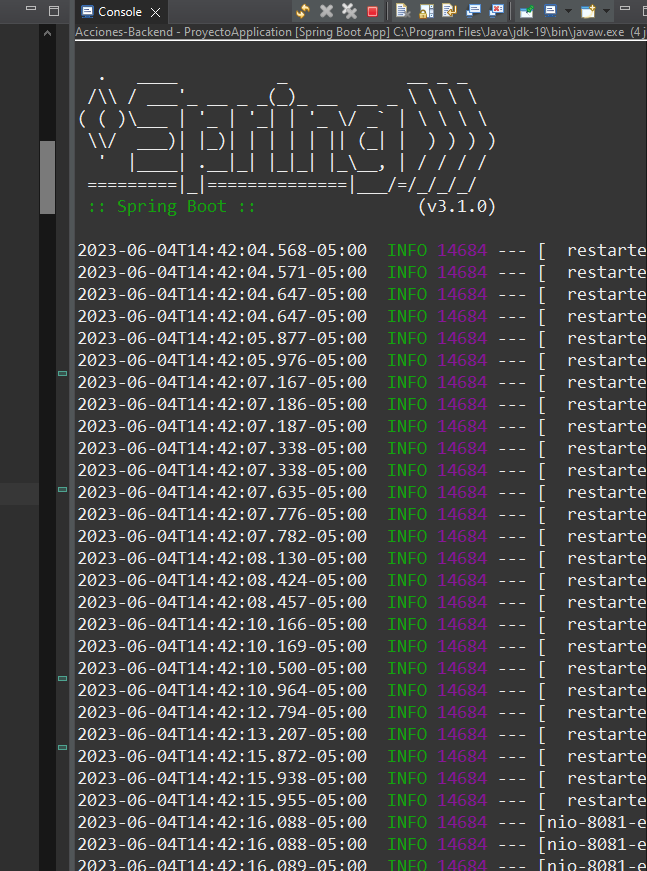
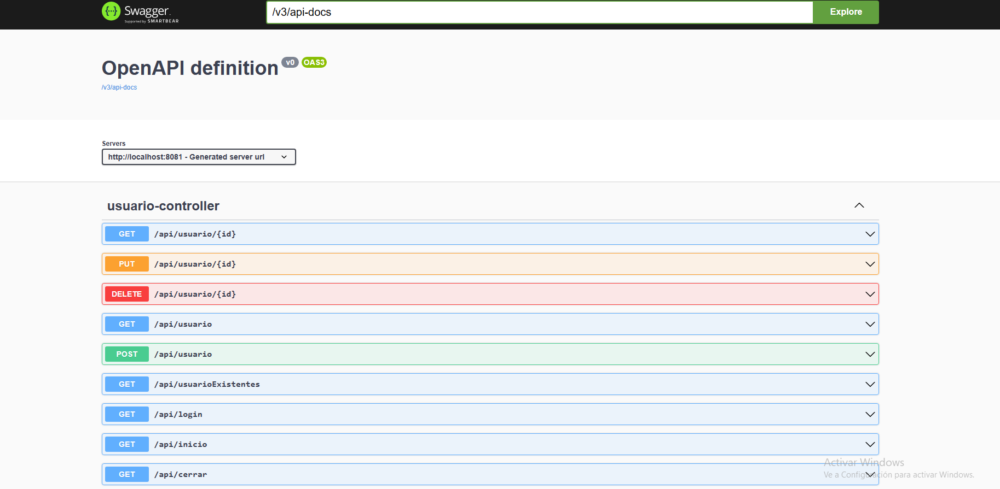

# Acciones Backend

API REST para un sistema de **gestión de acciones bursátiles** desarrollada con Spring Boot 3. Permite a usuarios comprar y vender acciones de empresas, registrar movimientos y consultar tendencias del mercado.

Frontend correspondiente: [Acciones-Frontend](https://github.com/revkelo/Acciones-Frontend)

---

## Funcionalidades

- CRUD de **empresas** con su información bursátil
- Registro de **acciones** por empresa
- Registro de **movimientos** de compra/venta por usuario
- Consulta de **tendencias** del mercado
- Gestión de **usuarios** con roles

---

## Stack

| | |
|--|--|
| Framework | Spring Boot 3 |
| Lenguaje | Java 17 |
| Base de datos | MySQL 8 |
| ORM | Spring Data JPA / Hibernate |
| Testing | JUnit 5 |
| Build | Maven |

---

## Entidades

| Entidad | Descripción |
|---------|-------------|
| `Empresa` | Empresa listada en bolsa |
| `Acciones` | Acciones disponibles por empresa |
| `Movimiento` | Transacciones de compra/venta |
| `Tendencia` | Tendencia de precio por empresa |
| `Usuario` | Usuario del sistema (inversionista/admin) |

---

## Endpoints principales

| Método | Ruta | Descripción |
|--------|------|-------------|
| `GET/POST/PUT/DELETE` | `/api/empresas` | CRUD empresas |
| `GET/POST/PUT/DELETE` | `/api/acciones` | CRUD acciones |
| `GET/POST` | `/api/movimientos` | Registro y consulta de transacciones |
| `GET` | `/api/tendencias` | Tendencias del mercado |
| `GET/POST` | `/api/usuarios` | Gestión de usuarios |

---

## Instalación

```bash
git clone https://github.com/revkelo/Acciones-Backend.git
cd Acciones-Backend
cp src/main/resources/application.properties.example src/main/resources/application.properties
# Editar application.properties con tus credenciales
mvn spring-boot:run
```

**Variables de entorno requeridas:**

```properties
DB_URL=jdbc:mysql://localhost:3306/acciones_db
DB_USERNAME=tu_usuario
DB_PASSWORD=tu_password
```

---

## Capturas

<p align="center">
  
  
</p>

---

Proyecto grupal — Universidad El Bosque, 2023  
**Kevin Gonzalez**
